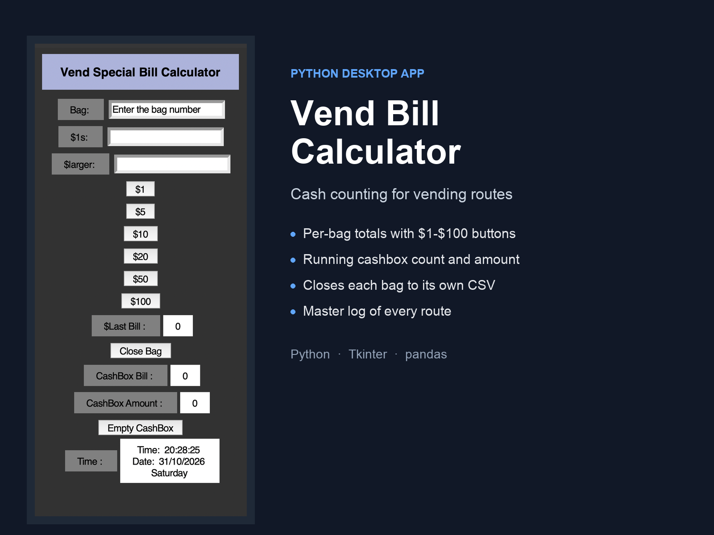

# BillCounter — Vending Route Cash Counter

A small desktop application for counting the cash collected from each bag on a
vending-machine route. The operator enters a bag number, taps the bill buttons
for every note in the bag, and closes the bag — the app records the total and
starts the next bag.



Built with Python and Tkinter. No database, no server, no network calls — it
writes plain CSV files you can open in Excel.

---

## Features

- **Bag-by-bag counting** — enter a bag number, then record the notes in it.
- **Denomination buttons** — `$1`, `$5`, `$10`, `$20`, `$50`, `$100`. The larger
  denominations accumulate into a running bag total as you tap them.
- **Live cashbox totals** — running amount and number of closed bags, so the
  operator can reconcile against the machine's own report.
- **CSV output** — `Close Bag` writes a per-bag file and appends the same row to
  a master log, so every bag stays traceable.
- **Live clock** — the window stamps the session date and time.
- **Cashbox reset** — `Empty CashBox` clears the session and starts fresh.

---

## Requirements

- Python 3.9+
- Tkinter (bundled with the standard Python installers on Windows and macOS;
  on Linux install `python3-tk`)
- pandas

`tkinter`, `csv` and `time` are part of the standard library.

---

## Installation

```bash
git clone https://github.com/Amr-MAgdi/BillCounter1.git
cd BillCounter1
pip install -r requirements.txt
```

---

## Running

The two source files import each other by name, so run the app from inside the
`P3` folder:

```bash
cd P3
python3 window.py
```

On Windows, use `python window.py` (or `py window.py`).

Output files are written to the directory you launch from — that is why the app
should be started from `P3/`.

---

## Usage

1. **Enter the bag number** in the first field (click it to clear the prompt).
2. **Count the one-dollar bills** — either type the count in `$1s`, or press the
   `$1` button once per note.
3. **Add the larger notes** — press `$5`, `$10`, `$20`, `$50` or `$100` for each
   note. They add up in the `$larger` field (e.g. `$20` + `$20` + `$5` = `45`),
   or you can type a total directly.
4. **Press `Close Bag`** — the bag is written to CSV, added to the cashbox
   totals, and `Last Bill` shows that bag's total.
5. **Repeat** for the next bag. The cashbox holds **three bags**; after that the
   app asks you to empty it.
6. **Press `Empty CashBox`** at the end of the run to reset the counter.

### Reading the totals

| Field | Meaning |
|---|---|
| `$1s` | One-dollar bills in the current bag |
| `$larger` | Running total of the `$5`–`$100` notes in the current bag |
| `Last Bill` | Total of the bag just closed (`$1s` + `$larger`) |
| `CashBox Bill` | Number of bags closed since the last reset |
| `CashBox Amount` | Cash total of those bags |

---

## Output files

`Close Bag` produces two things, both CSV:

**1. A file per bag, named after the bag number** — `101.csv`:

```csv
Bag ,1$,Large
101,3,45
```

**2. An appended row in the master log** — `test.csv`:

```csv
Bag,1$,Large
101,3,45
102,7,20
```

The per-bag columns are the bag number, the count of `$1` bills, and the total
value of the larger notes. The master log keeps one row per bag for the whole
run, which is the file to hand to accounting. `P3/test.csv` in this repository
is sample output from manual testing.

---

## Project structure

```
BillCounter1/
├── P3/
│   ├── window.py     # Tkinter layout and entry point
│   ├── main.py       # counting logic, CSV writing, cashbox state
│   ├── kl.py         # optional serial bill-acceptor scaffold (not wired in)
│   └── test.csv      # master log (sample data)
├── docs/
│   └── cover.png     # project cover image
├── requirements.txt
└── README.md
```

`window.py` builds the interface and `main.py` holds the callbacks, so the UI
layout and the counting/persistence logic stay separate.

### `kl.py` (optional)

`kl.py` is a starting point for reading notes directly from a serial bill
acceptor rather than typing them in. It is **not imported by the app** and the
serial protocol is a placeholder — the functions open a port, read a line and
print it. Running it requires `pyserial`:

```bash
pip install pyserial
python kl.py
```

The port defaults to `/dev/ttyUSB0` at 9600 baud; adjust `initialize_bill_acceptor()`
for your hardware.

---

## Limitations

- The cashbox is capped at **three bags** between resets. This is deliberate —
  it forces a reconciliation checkpoint — but it means `Empty CashBox` is part
  of the workflow, not an optional extra.
- Closing the same bag number twice overwrites that bag's CSV file (the master
  log keeps both rows).
- The bag number is used directly as the filename, so avoid characters that are
  illegal in file names.
- Input is only checked for being numeric; there is no validation that a bag
  number was actually entered.
- No automated tests. `test.csv` holds manual test output.
